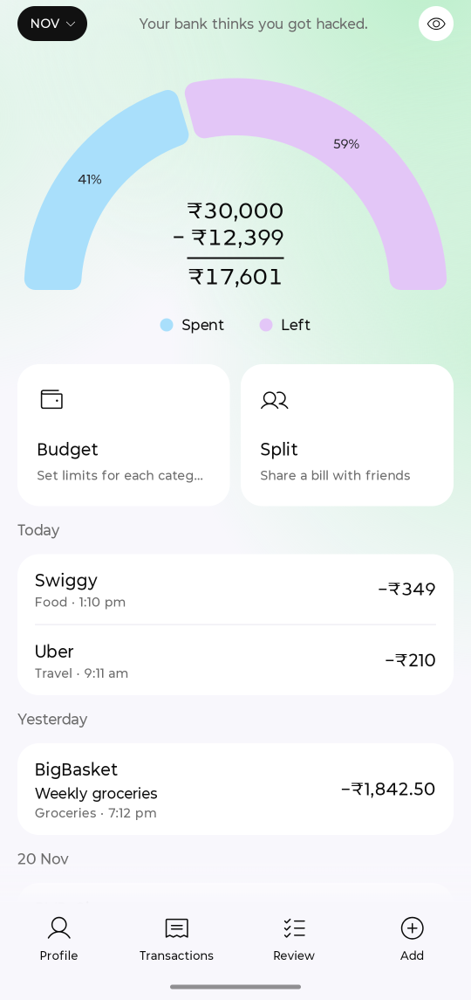

# Biko

A budget app for Android that tells you where your month stands before you
pay, and catches the UPI payments you forgot to add.

<p align="center">
  
</p>

<p align="center"><sub>Made-up data from the demo build.</sub></p>

## Download

**[Download Biko v0.1.0 (APK)](https://github.com/B-a-l-aj-i/biko/releases/download/v0.1.0/biko-v0.1.0.apk)**

All versions are on the [releases page](https://github.com/B-a-l-aj-i/biko/releases).

## Features

- **A monthly budget split into categories.** See what's spent and what's left at
  a glance, with a pace line that tells you if you're spending faster than the month.
- **A warning before you go over.** Adding or editing a payment shows what it
  does to that category's budget for the month it was made in.
- **UPI app alerts.** Biko reads the payment notifications of PhonePe, Paytm,
  Google Pay and Navi, and asks what each payment you didn't add was for.
  Nothing counts until you confirm it.
- **Your data stays on your phone.** Everything is one JSON file. No account,
  no server, nothing uploaded.
- **Backup.** Export your budgets, payments and voice notes to a single `.zip`
  file, and import it on a new phone.
- **Exact money.** Amounts are kept in paise, so every figure adds up to the paisa.

## Install

1. Download the APK above on your Android phone (Android 8.0 or newer).
2. Open it. If Android asks, allow your browser or file manager to install
   unknown apps.
3. To get payment alerts, open **Profile → Payment alerts → Turn on** and give
   Biko notification access.

## Build

You need a JDK 17 (Android Studio's bundled one works).

```sh
./gradlew :app:testDebugUnitTest   # unit tests for all the money math
./gradlew :app:assembleDebug       # app/build/outputs/apk/debug/app-debug.apk
./gradlew :app:assembleDemo        # a build filled with made-up data, for screenshots
```

Kotlin and Jetpack Compose. The money math lives in plain, unit-tested Kotlin
files under `app/src/main/java/com/budgetapp/data/`.
